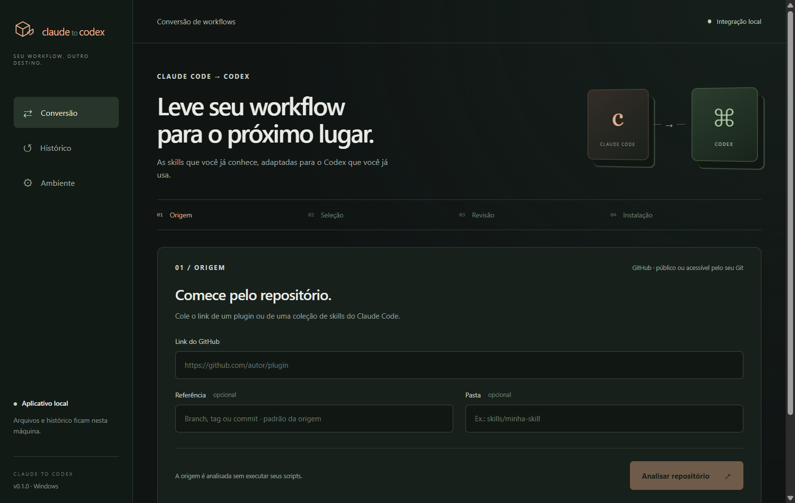

# Claude to Codex

Aplicativo Windows com janela própria para importar skills e plugins do **Claude Code**, adaptar componentes compatíveis e instalá-los no **Codex instalado na sua máquina**.

Cole um link do GitHub, selecione os componentes, revise os arquivos e instale. Inclui histórico local, comparação com a origem, exportação ZIP, atualização, remoção e recuperação. A instalação usa os comandos oficiais de plugins e o catálogo local do Codex.

**Versão 0.1.0 inicial.** Fluxos verificados no Windows x64 com Codex CLI 0.157.1. Recursos sem equivalente aparecem como impedimentos e bloqueiam a instalação. Consulte [compatibilidade](docs/COMPATIBILITY.md) e [validação](docs/VALIDATION.md).



## Requisitos

- Windows x64; validação realizada no Windows 11.
- [Git for Windows](https://git-scm.com/downloads/win) instalado.
- Codex com executável nativo e suporte a `plugin marketplace add`, `plugin add`, `plugin remove` e `plugin list --json`. A tela **Ambiente** verifica os recursos e permite selecionar `codex.exe` fora do PATH.
- Login no Codex para conversão assistida: `codex login`. O aplicativo reutiliza a autenticação oficial, sem pedir chave de API separada.
- Internet para baixar repositórios e usar o modelo. Repositórios privados dependem das credenciais Git já configuradas na máquina.

O instalador inclui o runtime do aplicativo. Não inclui Git, Codex ou dependências dos plugins importados.

## Executar e empacotar

Pelo código-fonte, com Node.js 24 ou superior:

```powershell
git clone https://github.com/vieiratechbr/claude-to-codex.git
cd claude-to-codex
npm ci
npm run build
npm start
```

No PowerShell, use `npm.cmd` se a política bloquear `npm.ps1`.

```powershell
npm run dist:win
```

Saída: `release/Claude-to-Codex-0.1.0-Windows-x64-Setup.exe`. Instalador por usuário, **sem assinatura digital**. A CI também gera um artifact; confira o resultado na aba Actions. macOS e Linux ainda não foram validados.

## Usar

1. Abra o aplicativo e confira **Ambiente**.
2. Cole uma URL de repositório, como `https://github.com/anthropics/skills`. Informe branch/commit e pasta nos campos separados, em vez de colar um link `tree/`.
3. Clique em **Analisar repositório**. Os objetos Git são lidos sem executar scripts, checkout ou filtros da origem.
4. Selecione skills/plugins. A conversão assistida envia as instruções selecionadas ao Codex; desative-a para usar apenas os adaptadores locais.
5. Revise impedimentos, avisos e arquivos. Exporte um ZIP para inspeção externa.
6. Clique em **Instalar no Codex**. Abra uma nova conversa ou reinicie o Codex para carregar as alterações.

Exemplo verificado: `https://github.com/anthropics/skills`, pasta `skills/frontend-design`; a revisão exata está em [VALIDATION.md](docs/VALIDATION.md). Revise instruções e recursos de terceiros antes de usá-los.

No **Histórico**, abra uma conversão, prepare uma atualização para revisão, remova uma instalação gerenciada ou recupere uma operação. Uma origem fixada em commit continua fixada nas atualizações.

## Dados, conta e recuperação

Dados ficam em `%APPDATA%/Claude to Codex`. O destino Codex usa `CODEX_HOME` ou `~/.codex`. Para um perfil alternativo do aplicativo, defina `CLAUDE_TO_CODEX_HOME` com caminho absoluto antes de abri-lo.

A conversão assistida usa `codex exec`, schema, sandbox de leitura e ferramentas desativadas. Não materializa código da origem no workspace do modelo. Depende de rede, disponibilidade e limites da conta Codex.

O catálogo gerenciado chama-se `claude-to-codex-local`. A ferramenta registra snapshots da configuração e do catálogo envolvidos. Recuperação compara o estado atual com o registrado; mudança externa gera conflito e preserva os arquivos atuais. Não apague os dados com recuperação pendente. **Limpar downloads** remove clones temporários e mantém histórico e recuperação.

Uma instalação reconhecida não comprova funcionamento dos scripts, MCPs ou integrações externas da skill. Eles podem exigir software, autorização e configuração próprios. Licenças das origens continuam aplicáveis.

## Verificação e contribuição

```powershell
npm run typecheck
npm test
npm run build
npm run test:desktop
npm run test:codex-local
npm run dist:win
npm run test:packaged
```

Testes de instalação usam `CODEX_HOME` temporário. Testes comuns não exigem login nem rede. Veja [contribuição](docs/CONTRIBUTING.md), [arquitetura](docs/superpowers/specs/2026-10-13-claude-to-codex-design.md) e [plano](docs/superpowers/plans/2026-10-13-claude-to-codex.md). O mantenedor trabalha diretamente na **main**.

## Licença e referências

A licença de distribuição do aplicativo aguarda definição do mantenedor. Publicar o código não concede automaticamente licença de reutilização. Recursos importados mantêm suas licenças; dependências têm licenças próprias incluídas no pacote.

- [Plugins do Codex](https://developers.openai.com/plugins/build/plugins)
- [Execução não interativa](https://learn.chatgpt.com/docs/non-interactive-mode)
- [Plugins do Claude Code](https://code.claude.com/docs/en/plugins-reference)

Projeto independente, sem afiliação oficial com Anthropic ou OpenAI.
